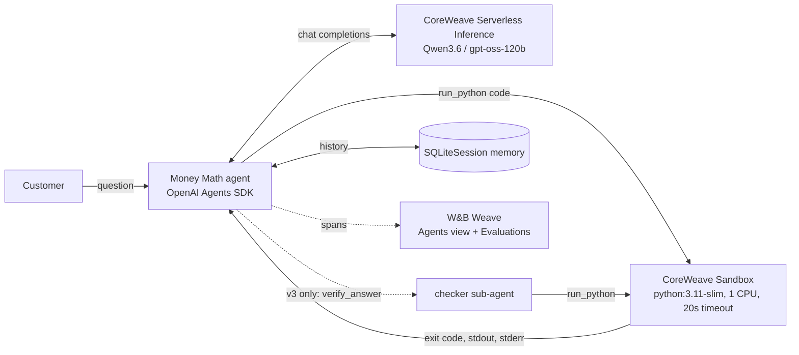

# Money Math: a sandboxed finance agent instrumented with W&B Weave

A personal-finance assistant (framed as a retail bank's customer assistant). LLMs make arithmetic and interpretation mistakes, so the agent writes Python and runs it in an isolated **CoreWeave Serverless Sandbox**, then answers with numbers that come from code you can inspect in the trace.

Everything runs on one W&B API key:

| Layer | Product |
|---|---|
| Observability, evals | **W&B Weave**: Agents view traces, `weave.Evaluation`, versioned datasets |
| LLM | **CoreWeave Serverless Inference** (OpenAI-compatible): Qwen3.6-35B-A3B, gpt-oss-120b |
| Code execution | **CoreWeave Serverless Sandboxes** (`cwsandbox`), one isolated container per conversation |
| Agent runtime | **OpenAI Agents SDK**: agent loop, tools, sessions (memory), agent-as-tool sub-agents |

## Architecture



**One turn:** the LLM plans → calls `run_python` → the sandbox executes it → the LLM reads stdout/stderr (and retries on errors) → it replies, ending in `FINAL ANSWER: <number>`. Every LLM call, tool call, sub-agent call, token and $ cost appears in the Weave Agents view.

## Agent versions (what the evals compare)

| Version | What changes |
|---|---|
| `v1_no_tool` | Baseline: the LLM does the math "in its head" |
| `v2_sandbox` | Must compute with `run_python` in a sandbox; reads errors and retries |
| `v3_sandbox_check` | v2 + a `checker` sub-agent (agent-as-tool) that recomputes the answer independently |
| `v4_clarify` | v2 + `numpy-financial` in the sandbox + an ambiguity policy: ask a clarifying question in chat; in one-shot evals, state `ASSUMPTIONS:` and an `ALTERNATIVE:` answer |

## Results (50 questions: 30 FinanceReasoning-Hard + 20 GSM-Symbolic-P2)

| Model | v1 no tool | v2 sandbox | v3 + checker | v4 clarify | $/question (v2) |
|---|---|---|---|---|---|
| Qwen3.6-35B-A3B | 90% | 90% | **92%** | 84% (89% excl. timeouts) | $0.0038 |
| gpt-oss-120b | 82% | 86% | **88%** | 84% | $0.00013 |

**Key findings**

> **Statistical caveat:** each cell is a single run on 50 questions. Paired McNemar tests on the model comparisons give p = 0.22–1.0, and the version gaps (2–6 points) are similar in size. Accuracy differences are *trends to confirm* with more questions and repeated trials, not proven effects. The cost and latency differences are large and robust.

- **Trend:** tools and verification appear to help the weaker model most (gpt-oss: 82 → 86 → 88%), while Qwen barely moves (90 → 90 → 92%).
- **Robust:** gpt-oss-120b is ~28× cheaper per question than Qwen3.6, which spends its budget on long reasoning output.
- **Robust on cost:** the v3 checker costs 1.7–3.5× more. Its benefit (+1–2 correct answers) is within noise, so in production I'd run it only on high-stakes answers.
- Most remaining "errors" are label or wording ambiguity, not arithmetic. v4 often states the correct reading as its alternative.
- **Judge alignment:** checked against human labels, the LLM ambiguity judge agreed only at chance level (κ = 0.03). It called 28/50 questions ambiguous; the human found 1. Judges must be validated before you trust them.
- **v4's ambiguity policy catches the real ambiguity but mostly adds hedging noise.** Against the human labels, gpt-oss named an alternative reading on 37/49 clear questions (Qwen: 15/49).
- **Scorer strictness:** with a precision-aware scorer (v1), only the no-tool versions lose answers (last-digit drift in mental math). gpt-oss goes 74% → 86% with the sandbox.

Full tables, latency percentiles, the failure review and the bugs found via traces are in [docs/RESULTS.md](docs/RESULTS.md). Product feedback is in [FEEDBACK.md](FEEDBACK.md).

## Setup

Requirements:
- Python 3.11+
- A W&B account and API key (https://wandb.ai/settings)
- Serverless Inference credits (included with new accounts)
- Sandboxes access (it worked out of the box on a free account)

```bash
git clone https://github.com/chaoyingzheng/myAgents && cd myAgents
uv venv --python 3.11 .venv     # recommended: guarantees Python 3.11 (needs uv: https://docs.astral.sh/uv/)
# or: python3.11 -m venv .venv  (check `python --version` first: plain `python` may be an older 3.8/3.9)
source .venv/bin/activate       # Windows: .venv\Scripts\activate
pip install -r requirements.txt # or: uv pip install -r requirements.txt
cp .env.example .env            # then edit .env
```

`.env`:
```
WANDB_API_KEY=<your key>
WEAVE_PROJECT=<your team entity>/mathAgent   # the *team* entity, not the "-org" name
MODEL_ID=Qwen/Qwen3.6-35B-A3B
```

Check all three services (Weave, Inference, Sandbox) with one script:
```bash
python scripts/smoke_test.py
```

## Run it

```bash
# Interactive chat with memory (live demo). Try: "$400k mortgage at 6.5% for 30 years?" then "what if I pay $500 extra?"
python -m money_math.chat --version v2_sandbox
python -m money_math.chat --version v4_clarify --model openai/gpt-oss-120b

# Scripted 2-turn conversation (demo backup)
python scripts/demo_conversation.py --version v2_sandbox

# 1) Build + publish the eval dataset to Weave (versioned), then add the human ambiguity labels
#    (docs/ambiguity_review.xlsx) as a new version. Run both, in this order: build_dataset
#    publishes a new :latest WITHOUT the labels.
python -m evals.build_dataset
python -m evals.add_human_labels

# 2) Evaluate versions (start with --limit to save credits)
python -m evals.run_eval --versions v1_no_tool v2_sandbox --limit 10
python -m evals.run_eval --versions v1_no_tool v2_sandbox v3_sandbox_check v4_clarify --model openai/gpt-oss-120b --parallel 20

# 3) Summaries pulled back from Weave
python scripts/eval_report.py --hours 3 --wrong   # accuracy, latency, tokens, $ per eval
python scripts/alt_metric.py --hours 3            # timeouts, "correct among stated readings" (full 50-question runs only)
python scripts/inspect_turn.py --n 2              # print the latest agent turns (LLM + tool calls)

# 4) Evaluate the evaluation (no agent rerun; results are attached to saved answers as versioned feedback)
python -m evals.judge_alignment                   # LLM ambiguity judge vs human labels (Weave Evaluation, Cohen's kappa)
python scripts/rescore.py [--apply]               # re-score saved answers with the current numeric_match version
python scripts/rejudge_flags.py                   # re-judge "did the reply flag an ambiguity?" vs human labels (logs to Weave)
```

Tip: point `WEAVE_PROJECT` at a fresh project when reproducing, so your runs don't mix with existing results.

Results show up at `https://wandb.ai/<entity>/<project>/weave`: **Agents** (traces), **Evals** (compare versions), **Datasets** (`money_math_eval` versions).

## Repo layout

```
money_math/
  config.py          env, weave.init, Inference client (timeout + retries)
  sandbox_tool.py    run_python tool: per-conversation sandbox, exec timeout, stderr feedback, no-number guard
  agents_def.py      v1–v4 agent definitions, prompts, model-aware tool_choice
  chat.py            interactive CLI with SQLiteSession memory
evals/
  build_dataset.py   FinanceReasoning-Hard + GSM-Symbolic-P2 sample -> weave.Dataset
  add_human_labels.py  human ambiguity labels (docs/ambiguity_review.xlsx) -> new dataset version
  scorers.py         numeric_match (precision-aware), followed_format, tool_usage,
                     judge_question_ambiguity + flags_ambiguity (LLM judges)
  run_eval.py        weave.Model wrapper + weave.Evaluation per version, --parallel, --limit
  judge_alignment.py LLM judge vs human labels, as a Weave Evaluation
  finance_questions.py  hand-written questions from dataset v1 (retired, kept for reference)
scripts/             smoke_test, demo_conversation, eval_report, alt_metric, inspect_turn,
                     rescore (re-score saved answers), rejudge_flags (re-judge saved answers)
docs/RESULTS.md      every run, finding and bug, in order
docs/ambiguity_review.xlsx  human ambiguity labels (blind review of all 50 questions)
FEEDBACK.md          product feedback (Weave, Inference, Sandboxes)
```

## Design decisions

- **Sandbox per conversation, not per call.** Cold start (median ~5s) is paid once; follow-up turns reuse the container. Evals use a fresh sandbox per question for isolation.
- **Fail loudly to the model.** The tool returns the exit code and stderr, and warns when stdout contains no numbers. That fixed a real hallucination found in a trace, where the model printed `${M:.2f}` literally and then invented a number.
- **Force the first tool call** (`tool_choice="required"`, reset to auto after one call) because a chatty prompt made the model describe the computation without running it. It's model-aware: gpt-oss returns empty replies with `required`.
- **Timeouts:** the 600s client default let one hung request stall an entire eval. Now it's 180s plus 2 retries; reasoning models need the headroom.
- **Eval data:** recent, public, contamination-resistant benchmarks. GSM8K was dropped because the no-tool baseline scored 98% (likely memorized).

## Troubleshooting

- `SyntaxError` / install failures: you're on Python < 3.10. Create the venv with Python 3.11 (see Setup).

- `you may not create the generic project ... under your org`: use your **team** entity in `WEAVE_PROJECT`, not the `-org` name.
- An empty reply from `openai/gpt-oss-*`: don't force `tool_choice="required"` (already handled in `agents_def.py`).
- `APITimeoutError` on long reasoning answers: raise `timeout` in `money_math/config.py`.
